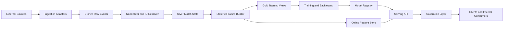
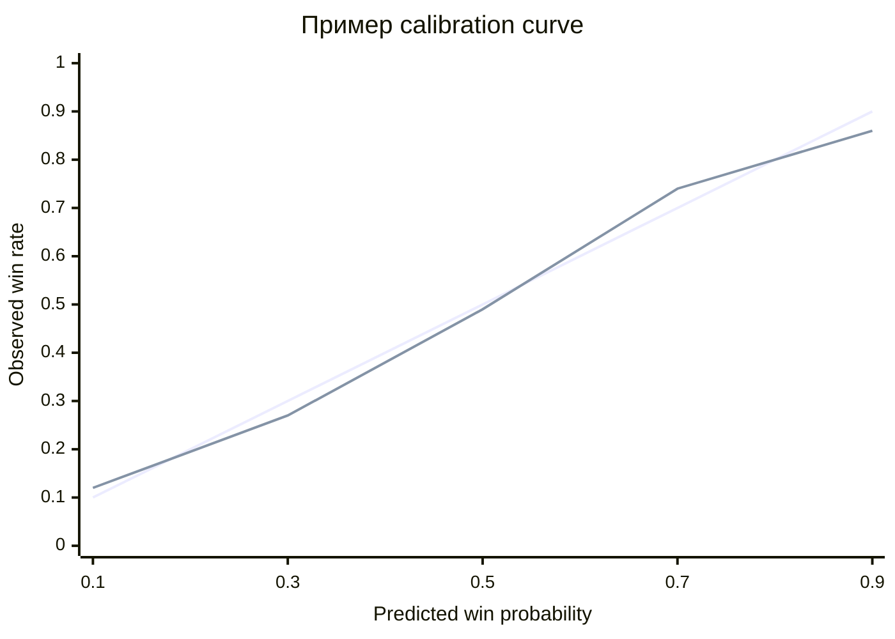
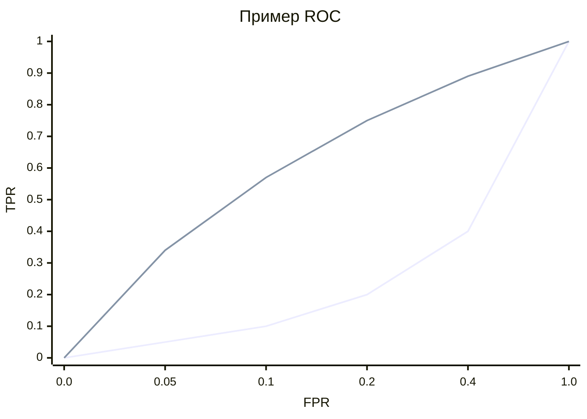
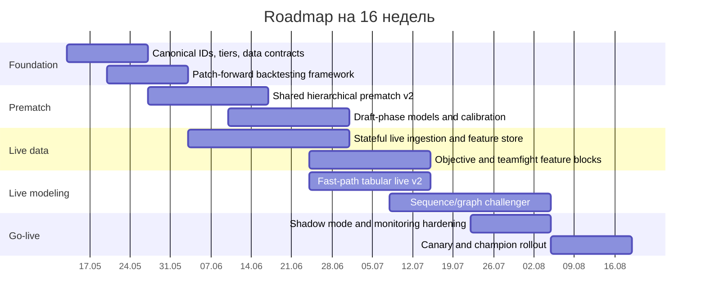

# Практический план подготовки предсказательных моделей для Dota 2 prematch и live у профессиональных команд T1–T3

## Краткое резюме

По вашему артефакту Aegis система уже имеет сильный prematch-baseline: лучший текущий prematch-контур на LightGBM (градиентном бустинге над деревьями) показывает 78.9% accuracy на T2 и 78.5% на all, а live-контур сейчас выигрывает у prematch-only baseline примерно на 4.85 п.п. по accuracy. Но в текущем виде это **хороший prematch v1 и еще не production-grade live-stack**: live собирается polling-моделью раз в 60 секунд и дедуплицируется в 3-минутные bucket’ы, live draft coverage (покрытие драфта) всего 19%, для большинства live snapshot’ов building state отсутствует, а prematch prior (прематч-приор) часто подменяется нейтральным 0.5 из-за неполной rehydration (восстановления) prematch-скоров. fileciteturn0file0 fileciteturn0file0L57-L69 fileciteturn0file0L236-L269 fileciteturn0file0L330-L336

Главный вывод: следующий скачок качества даст не “более сложная нейросеть”, а переделка **data plane (слоя данных)** и **evaluation plane (слоя оценки)**. Для вашей постановки оптимальная целевая связка такая:  
**prematch** — иерархический rating prior (рейтинг-приор) на уровне команды/игроков плюс shared booster (общий бустинговый контур);  
**draft-phase** — отдельный phase-aware model (модель, учитывающая фазу драфта);  
**live** — stateful event-driven pipeline (stateful-пайплайн, хранящий состояние матча и обновляющийся по событиям) плюс двухконтурная модель: быстрый tabular fast path (табличный быстрый контур) и sequence/graph challenger (последовательностный/графовый challenger);  
**validation** — только patch-forward и prequential evaluation (последовательная оценка по мере поступления данных), а champion selection (выбор боевой модели) — по logloss, Brier score (среднеквадратичной ошибке вероятности) и calibration (калибровке), а не по accuracy. ([scikit-learn.org](https://scikit-learn.org/stable/modules/generated/sklearn.model_selection.TimeSeriesSplit.html))

Если доступ к **official low-latency live feed** (официальному низколатентному лайв-фиду) не указан и не законтрактован, то модели для микро-горизонтов типа “следующее событие за 10–30 секунд” обещать нельзя. Публичный контур Valve/OpenDota/STRATZ годится для historical enrichment (исторического обогащения) и coarse live (грубого лайва), но для real-time вероятностей с обновлением каждые 1–5 секунд нужен commercial/official feed (коммерческий или официальный поток событий). ([wiki.teamfortress.com](https://wiki.teamfortress.com/wiki/WebAPI?utm_source=chatgpt.com)) fileciteturn0file0L342-L348

## Контекст, scope и стек источников

Внешний data backbone (опорный контур данных) для такой системы лучше строить вокруг entity["company","Valve","game developer"] как канонического источника match/league identifiers (идентификаторов матчей и лиг), entity["organization","OpenDota","dota data platform"] и entity["organization","STRATZ","dota stats api"] как enrichment-слоя, entity["organization","Liquipedia","esports wiki"] и entity["organization","datdota","pro dota statistics"] как metadata-слоя pro-сцены, а entity["company","GRID","esports data platform"], entity["company","Abios","esports api"] и entity["company","PandaScore","esports api"] — как кандидатов на official/commercial live feed. Valve через Dota Web API покрывает `GetLiveLeagueGames`, `GetMatchDetails`, `GetMatchHistory*` и team info; Steam Web API требует API key. OpenDota дает replay-parsed enrichment и health/request endpoints, STRATZ — GraphQL API (графовый API), Liquipedia — структуру турниров/составов/tier labels (tier-меток), datdota — pro-only статистику и win expectancy (ожидаемую вероятность победы), GRID/Abios/PandaScore — real-time/in-play feeds (лайв-фиды для матча). ([steamcommunity.com](https://steamcommunity.com/dev?utm_source=chatgpt.com))

Рабочее правило фильтра T1–T3 я бы фиксировал не только по внутреннему rating bucket (рейтинг-бакету), а через **двойную разметку**: `tournament_tier` из Liquipedia и `team_strength_bucket` из вашей латентной рейтинговой модели. Это снижает ошибки на roster reset (перестройке состава) и на региональных перекосах strength of schedule (силы календаря). Для patch/meta segmentation (патчевой и метовой сегментации) используйте официальные русскоязычные patch notes: на дату 12 мая 2026 игра уже находится в ветке 7.41c, а ветки 7.39–7.41 содержали значимые изменения карты, объектов и макро-ритма. Ваш текущий артефакт уже показывает, что окно 365 дней лучше 540 дней, но я бы заменил hard cutoff (жесткий cutoff, отсечение) на decay-weighted sampling (выборку с затухающим весом). urlРусскоязычные patch notes 7.41cturn31search0 urlНовости Dota 2 на русскомturn31search4 fileciteturn0file0L20-L24

Для краткости ниже использую легенду источников: **V** = [Steam Web API docs](https://developer.valvesoftware.com/wiki/Steam_Web_API?utm_source=chatgpt.com), **OD** = [OpenDota API docs](https://docs.opendota.com/?utm_source=chatgpt.com), **ST** = [STRATZ API](https://stratz.com/api?utm_source=chatgpt.com), **LP** = urlLiquipedia APIturn21search2, **DD** = urldatdotaturn21search3, **GV** = urlGRID Series Eventsturn22search21 / urlAbios Dota channelsturn22search0 / urlPandaScore stats docsturn21search5, **RP** = urlOpenDota parserturn11search0 + urlClarity parserturn11search1, **INT** = ваш internal warehouse (внутреннее хранилище). Governance (правила эксплуатации) тоже важен: Liquipedia публикует API Terms of Use, STRATZ rate-limits токены, Steam требует безопасного хранения API key, OpenDota допускает работу без ключа, но с более низкими лимитами, а при обогащении игровых данных персональными атрибутами начинает применяться GDPR (европейский регламент по защите персональных данных). ([partner.steamgames.com](https://partner.steamgames.com/doc/webapi_overview/auth?utm_source=chatgpt.com))

| Слой | Основной провайдер | Что брать | Режим обновления | Практический комментарий |
|---|---|---|---|---|
| Canonical IDs и bare match facts | [Steam Web API docs](https://developer.valvesoftware.com/wiki/Steam_Web_API?utm_source=chatgpt.com) | match_id, league_id, team ids, базовые live/historical facts | request-driven | Канон для идентификаторов и reconciliation (сшивки) |
| Public enriched stats | [OpenDota API docs](https://docs.opendota.com/?utm_source=chatgpt.com), [STRATZ API](https://stratz.com/api?utm_source=chatgpt.com) | team/player/hero stats, ratings, pros, parsed fields | batch + partial live | Хорошо для enrichment, но не равно official low-latency feed |
| Esports metadata и tier mapping | urlLiquipedia APIturn21search2 | турниры, составы, сетки, tier labels, расписание | event-driven + batch snapshot | Главный внешний слой для T1/T2/T3 scope definition |
| Pro-only benchmark | urldatdotaturn21search3 | draft analysis, pro stats, win expectancy | batch | Отличный внешний sanity check (проверка здравого смысла) |
| Official/commercial live | urlGRID Series Eventsturn22search21, urlAbios Dota channelsturn22search0, urlPandaScore stats docsturn21search5 | live series events, in-play stats, rich event stream | real-time / near-real-time | Нужен для high-frequency live |
| Replay/deep parse | urlOpenDota parserturn11search0, urlClarity parserturn11search1 | event logs, coordinates, cooldown/item usage, fight signals | post-match async parse | Ключ к spatial/teamfight features |

Не указано: доступ к odds feed (потоку коэффициентов), контракт на official live vendor, целевое SLA, retention policy (политика хранения) для реплеев, и юридическая рамка кроме ЕС.

## Полный каталог фичей

Я бы проектировал фичи не как “один длинный список столбцов”, а как **typed feature families** (типизированные семейства признаков) с обязательными полями `event_time`, `source`, `source_age_sec`, `missing_reason`, `schema_version` и `roster_version`. Ключевое правило anti-leakage (защиты от утечки): prematch-признак фиксируется не позже `map_start_ts`, live-признак — строго as-of текущего `event_time`. Для historical training используйте point-in-time joins (временные as-of соединения), иначе leakage неизбежен. ([docs.feast.dev](https://docs.feast.dev/getting-started/concepts/point-in-time-joins))

| Блок prematch-фич | Конкретные фичи | Источник | Частота обновления | Формат | Агрегация / нормализация | Приоритет |
|---|---|---|---|---|---|---|
| Match context | `match_id`, `series_id`, `bo_type`, `map_no`, `scheduled_start_ts`, `region`, `stage`, `LAN_online_flag` | V, LP, INT | при любом schedule change | categorical + timestamp | one-hot / target encoding, cyclical time | P0 |
| Tier and competition quality | `tournament_tier`, `team_strength_bucket`, `strength_of_schedule_30d/90d`, `opponent_quality_index` | LP, DD, INT | after each completed map | scalar + ordinal | robust z-score внутри patch×region | P0 |
| Patch/meta context | `patch_id`, `major_patch_id`, `minor_patch_id`, `patch_age_days`, `days_since_hotfix`, `meta_volatility_index` | V, OD, ST, INT | patch-driven + daily | categorical + scalar | patch family one-hot; log1p on age | P0 |
| Team latent strength | `team_mu`, `team_sigma`, `patch_specific_rating`, `side_adjusted_rating`, `recent_delta`, `volatility` | INT, OD, ST | after each map | scalar | Glicko2/TrueSkill posterior, uncertainty отдельно | P0 |
| Roster stability | `stable_five_flag`, `days_since_roster_change`, `sub_count_30d`, `shared_maps_core3/core5`, `standin_flag` | LP, ST, OD, INT | roster change + after map | scalar + binary | recency decay, log1p, missing flags | P0 |
| Player skill | per-player `mu`, `sigma`, `role_mu`, `role_sigma`, `form_10_maps`, `hero_specific_skill`, `patch_skill_delta` | OD, ST, INT | after each map | 5×d tensor или aggregated scalars | role-aware aggregation: mean/max/min/std | P0 |
| Role/lane compatibility | `role_entropy`, `lane_pair_stability`, `support_core_synergy`, `roaming_propensity` | OD, RP, ST, INT | after each map | scalar + graph edge stats | Bayesian shrinkage к role prior | P1 |
| Team style profile | `kills_per_min`, `deaths_per_min`, `game_duration_mean`, `farm_gini`, `fight_frequency`, `smoke_rate`, `highground_rate` | OD, RP, DD | daily / after map | scalar | windows 5/10/20 maps + 30/90/365d | P0 |
| Objective priors | `first_blood_rate`, `tower_by_15m`, `first_roshan_rate`, `tormentor_rate`, `buyback_late_rate` | RP, OD, ST, DD | after map | scalar | Beta-Binomial shrinkage, patch-normalization | P1 |
| Hero pool / comfort | `hero_pool_entropy`, `comfort_pick_score`, `signature_hero_flag`, `player_hero_samples`, `hero_role_flex_prob` | OD, ST, DD, INT | after map / patch | sparse vector + scalar | hero win-rates shrink to role mean | P0 |
| Draft-phase priors | `ban_phase_value`, `target_ban_exposure`, `blind_pick_risk`, `response_quality_prior` | LP, DD, INT | per draft action | categorical + scalar | phase-specific encoding | P1 |
| Full-draft structure | hero ids by phase, synergy/anti-synergy, lineup embedding, initiation/save/push scores, timing curve | OD, ST, DD, RP, INT | after each pick/ban | sparse set / embedding / graph snapshot | set encoder или graph encoder, per-patch hero embeddings | P0 |
| Head-to-head / style clash | `h2h_recent_wr`, `style_cosine_distance`, `tempo_clash`, `draft_denial_matchup`, `regional_clash` | OD, DD, LP, INT | after map | scalar | strong shrinkage, roster-aware vs org-aware separately | P1 |
| External priors | market implied probability, line movement, consensus line | не указано / commercial | контрактнозависимо | scalar | хранить отдельно от pure model | P2 |
| Data quality | `has_full_draft`, `has_roster_confidence`, `feature_age_sec`, `sample_size_support`, `source_completeness` | INT | every materialization | scalar + binary | mandatory missing indicators | P0 |

| Блок live-фич | Конкретные фичи | Источник | Частота обновления | Формат | Агрегация / нормализация | Приоритет |
|---|---|---|---|---|---|---|
| Feed metadata | `event_time`, `ingest_time`, `source_age_sec`, `source`, `latency_ms`, `event_seq`, `out_of_order_flag` | GV, V, OD, INT | event-driven 1–5s; fallback 15–60s | scalar + categorical | используются напрямую; критичны для abstention (отказа) | P0 |
| Core scoreboard | `elapsed_sec`, `score_diff`, `kills_r/d`, `networth_diff`, `xp_diff` | GV, V, OD, ST | 1–5s / polling | scalar | side-symmetric diffs/ratios; per-minute normalization | P0 |
| Economy state | team/player `networth`, `gpm`, `xpm`, `gold_spent`, `gold_share_core/support`, `economy_slope_30/60/180s` | GV, RP, OD, ST | 1–5s | scalar + 10×d tensor | rolling slopes + EWMA | P0 |
| Hero state | per hero `level`, `alive_flag`, `respawn_timer`, `hp_pct`, `mana_pct`, `position`, `lane_zone` | GV, RP | event-driven / parsed frames | 10×d tensor | normalize by role and game phase | P1 |
| Cooldowns / buybacks | `buyback_available`, `buyback_cd`, `ultimate_cd`, `BKB_cd`, `save_spell_cd`, `glyph_status` | RP, GV | event-driven | tensor + scalar | binary thresholds + min/max in window | P1 |
| Inventory / power spikes | item ids, charges, neutral tier, `power_spike_score`, `3_core_bkb_ready_flag`, `aegis_holder_flag`, `ward_inventory_count` | RP, GV, ST | event-driven | sparse set + scalar | item embeddings + handcrafted spike flags | P0 |
| Objective state | tower HP/state, barracks, outposts/watchers, base exposure, lane pressure | GV, RP, V, OD | event-driven | scalar + categorical | cumulative objective score + time-since-objective | P0 |
| Neutral-objective timers | `roshan_alive`, `next_roshan_window`, `aegis_remaining`, `tormentor_alive`, `lotus_cycle` | RP, GV | event-driven | timers + scalar | circular time-to-event encoding | P0 |
| Vision / map control | obs/sentry counts, deward rate, smoked units, map occupancy, deep-ward penetration | RP, GV | every 5–15s | scalar + spatial tensor | rolling 60/180s windows | P1 |
| Spatial / formation | pairwise distances, convex hull area, centroid velocity, split-push index, enemy-jungle penetration | RP, GV | every 5–10s | graph snapshot + scalar | graph features + standardized spatial bins | P1 |
| Event windows | last N kills/deaths/objectives/buybacks/runes/smokes; `gold_swing_last_fight`, `fight_count_180s` | RP, GV, INT | event-driven | sequence tensor | windows 10/30/60/180s и last 5/10/20 events | P0 |
| Teamfight embedding | initiator, casualty pattern, spell expenditure, buyback trade, fight location, fight quality | RP | per detected fight | sequence / embedding | spatiotemporal clustering fights | P1 |
| Tempo / phase | `phase_early_mid_late`, `nw_x_phase`, `xp_x_phase`, `expected_next_fight_time` | INT, GV, RP | every update | scalar | phase-conditioned transforms | P0 |
| Draft / prematch priors | `prematch_logit`, lineup embedding, patch-meta score, style-clash prior | INT, OD, ST | once at draft lock, reused live | scalar + embedding | inject in logit space, не оставлять 0.5 без явной причины | P0 |
| Prediction memory | `prev_pred`, `pred_delta_30s`, `pred_volatility`, `confidence_decay` | INT | every inference | scalar | safe, если только исторические предсказания | P1 |
| Quality / missingness | `has_building_state`, `has_draft`, `has_coordinates`, `quality_class`, `domain_real_vs_backfill` | INT | every update | scalar + binary | mandatory; используется и в модели, и в routing | P0 |

Практический стандарт агрегации: prematch-окна `maps_{5,10,20}` и `days_{7,30,90,365}`; live-окна `sec_{10,30,60,180}` и `events_{5,10,20}`. Все доли и винрейты — через Bayesian shrinkage (сжатие к prior, априорному среднему), все count-based features (счетчики) — через `log1p`, все continuous features (непрерывные признаки) — через robust z-score внутри `patch × tier × role`, а все source-dependent features (зависимые от источника признаки) — с отдельным missing mask (индикатором пропуска). Для current Aegis это особенно важно, потому что tower/building state сейчас используется при высокой missingness, что статистически опаснее, чем явный dropout такого блока. fileciteturn0file0L307-L314 fileciteturn0file0L332-L334

## Задачи, модели и валидация

Таргеты я бы раскладывал не в одну “универсальную win model”, а в **портфель задач**. В Dota 2 “раунды” как сущность **не указаны** и предметно неестественны; корректные единицы — карта, серия, draft-phase и live event horizon. Для probabilistic outputs (вероятностных выходов) primary metric должен быть logloss, а не accuracy; Brier и calibration обязательны, ROC-AUC полезен, но вторичен. ([scikit-learn.org](https://scikit-learn.org/stable/modules/generated/sklearn.metrics.log_loss.html))

| Цель | Формулировка | Primary metric | Secondary metrics | Рекомендуемая схема валидации |
|---|---|---|---|---|
| Prematch winner карты | binary classification | logloss | Brier, ECE, ROC-AUC, accuracy | rolling-origin by patch, group by series/map |
| Winner серии | structured classification / simulation | series logloss | Brier, calibration by bo_type | leave-latest-event-out |
| Outcome after each draft phase | phase-aware classification | phase logloss | ECE, lift over prior | split by match and patch |
| Live winner end-of-map | binary classification `P(win_final | state_t)` | logloss | Brier, ECE, time-sliced AUC | prequential per map |
| Live winner on horizons Δt | multi-horizon classification | mean logloss over horizons | horizon-wise Brier/ECE | grouped rolling-origin |
| Next objective | competing-risks hazard | cause-specific logloss | macro-F1, time-dependent AUC | event-time forward split |
| Time-to-finish / remaining kills | survival / quantile / distributional regression | CRPS / pinball | MAE, RMSE | rolling-origin by patch |
| Draft recommendation | ranking / policy learning | NDCG@k, MRR | Recall@k, hit@k | patch-forward, phase-aware |

| Класс моделей | Где применять | Сильные стороны | Ограничения | Вердикт |
|---|---|---|---|---|
| Hierarchical Bradley–Terry / Glicko2 / TrueSkill | team/player prior | хорошо на малых выборках, uncertainty-aware | контекст матча нужен отдельно | **Обязательный prior-layer** |
| Logistic / Elastic Net / FTRL | fast baseline, live fast path | интерпретируемость, онлайн-обновление, минимальная latency | плохо ловит сложные draft interactions | **Обязательный baseline и fallback** |
| LightGBM / CatBoost | prematch main, live tabular main | лучший risk-return на табличных фичах | легко overfit на T1 и sparse live | **Основной champion для prematch** |
| Factorization Machines / DeepFM | sparse draft / interactions | хорошо на player×hero×team interactions | сложнее регуляризовать и калибровать | **Challenger для draft** |
| TCN / LSTM / TFT | live sequence, multi-horizon | ловят динамику и order effects (эффекты порядка) | требовательны к объему и качеству event feed | **Challenger после усиления live-data** |
| Static/Temporal GNN | roster graph, synergy graph, fight graph | сильны на compatibility/interactions | эксплуатационно тяжелые, тонки к leakage | **R&D track, не первый боевой шаг** |
| Survival / hazard models | next objective, duration | предметно правильны для time-to-event задач | сложнее serving/calibration | **Очень рекомендую для event targets** |
| Online learners + drift detectors | post-patch adaptation | быстрый drift response | ограниченная expressiveness | **Adaptation layer, не sole model** |

Практически значимые работы для этой архитектуры: urlApplications of Machine Learning in Dota 2turn23search20, urlDraft-Analysis of the Ancientsturn24search1, urlA Recommender System for Hero Line-Ups in MOBA Gamesturn24search2, urlThe Art of Draftingturn24search14, urlDOTA 2 match prediction through deep learning team fight modelsturn24search21, urlNeuralACturn23search12, urlTemporal Graph Networksturn14search1, urlTemporal Fusion Transformersturn14search0, urlLightGBM paperturn12search3, urlGlicko-2turn12search0 и urlTrueSkillturn12search1. В терминах execution (исполнения) это означает простой приоритет: сначала ratings + tabular + calibration; потом sequence; потом graph. ([ceur-ws.org](https://ceur-ws.org/Vol-1842/paper_05.pdf))

Процедуры backtesting (бэктестинга) должны быть жесткими:  
`prematch` — rolling-origin split (скользящий временной split) по patch family с группировкой по series_id/map_id;  
`live` — prequential evaluation на уровне map trajectory (траектории карты), где одна и та же карта никогда не дробится на train/test snapshot-wise;  
`HPO` (hyperparameter optimization, гиперпараметрическая оптимизация) — nested time split (вложенный временной split) внутри train period;  
`calibration` — отдельный calibration slice по времени, а не случайный holdout. Это важнее любого model exotica (экзотического класса моделей), потому что в esports главный враг — leakage across time, patches and multiple snapshots of the same map (утечка через время, патчи и множество snapshot’ов одной карты). ([scikit-learn.org](https://scikit-learn.org/stable/modules/generated/sklearn.model_selection.TimeSeriesSplit.html))

## Live-пайплайн и инфраструктура

Для live я бы проектировал не таблицу snapshot’ов, а **event-sourced state machine** (машину состояний, восстанавливаемую из событий). Минимальный canonical event contract (канонический контракт события): `event_id`, `match_id`, `series_id`, `game_no`, `event_time`, `ingest_time`, `source`, `source_seq`, `patch_id`, `entity_type`, `entity_id`, `payload_json`, `missing_mask`, `schema_version`. Из этого строятся три слоя: **bronze** — сырой append-only log, **silver** — normalized match state (нормализованное состояние матча), **gold** — feature views для train/serve. Prematch и live должны читать фичи из одного registry (реестра), иначе online/offline skew будет постоянной проблемой. ([docs.feast.dev](https://docs.feast.dev/getting-started/concepts/point-in-time-joins))

Разделение по statefulness (состоянию) должно быть жестким. **Stateful-компоненты**: match reducer keyed by `match_id+game_no`, ring buffer последних событий, objective timers, late/out-of-order reconciliation, horizon label simulator. **Stateless-компоненты**: model serving, calibration transform, API edge. Практичный стек — поток сообщений на urlApache Kafka docsturn17search1, stateful stream processing (stateful-обработку потока) на urlApache Flink docsturn18search1, point-in-time feature registry на urlFeast docsturn19search7 и low-latency analytical store (низколатентное аналитическое хранилище) на urlClickHouse docsturn17search3. Все эти компоненты не обязательны именно в таком брендовом составе, но capabilities (способности), которые вам нужны, именно такие: event-time semantics (семантика времени события), keyed state (состояние по ключу матча), exactly-once/near-exactly-once ingestion (почти-однократная доставка), point-in-time joins и быстрый online feature lookup (онлайновый доступ к фичам). ([kafka.apache.org](https://kafka.apache.org/documentation/))

SLO (service level objective, целевой уровень сервиса) я бы задал в двух режимах.  
**Если есть official/commercial live feed**: `p50` ingest-to-predict < 1.5 c, `p95` < 5 c, inference cadence (частота прогноза) 1–5 c вокруг ключевых событий.  
**Если есть только public feed**: горизонты надо укрупнять; pipeline можно держать на 15–60 c, но это уже не live pricing-grade (не уровень для тонкого live-pricing), а скорее broadcast-grade analytics (уровень аналитики для трансляции). Ваш текущий worker с 60-секундным poll interval и 180-секундным rounding — это acceptable baseline для coarse live, но не для action-rich Dota teamfight windows (плотно насыщенных событийных окон замесов). fileciteturn0file0L239-L242

## Эксперименты, drift-контроль и мониторинг

Экспериментальный контур я бы построил как **offline gate → shadow mode (теневой режим) → canary (канареечный rollout) → champion/challenger A/B**. Для низкотрафикового T1/T2/T3 домена полноценный A/B тест на уровне snapshot’ов неправильный: единица рандомизации — `series_id` или `match_id`, а не отдельный snapshot, иначе вы получите interference (взаимное влияние наблюдений). HPO — multi-objective (многоцелевая): оптимизируйте минимум `logloss + Brier + ECE + serving_penalty`, а не только accuracy. Drift-контроль нужен двух типов: **hard reset on patch family change** и **soft online drift detection** на feature/logloss stream. Для online drift practical choice (практический выбор) — ADWIN/DDM-класс детекторов; для post-hoc quality drift — prequential logloss/Brier. ([scikit-learn.org](https://scikit-learn.org/stable/modules/calibration.html))

| Что мониторить | Метрика | Alert policy (политика алерта) | Cadence (частота) |
|---|---|---|---|
| Probabilistic quality | logloss by patch/tier/horizon | warn: +10% к 28d baseline; crit: +20% | hourly / daily |
| Calibration | Brier, ECE, calibration slope/intercept | warn: ECE > 0.03; crit: > 0.05; slope вне [0.9,1.1] | daily |
| Discrimination | ROC-AUC, PR-AUC | warn: существенное падение vs baseline | daily |
| Data freshness | source lag, snapshot age, event delay | official: warn > 5 c, crit > 15 c; public: warn > 90 c | minutely |
| Missingness | доля пропусков по critical features | warn > 1%; crit > 5% | minutely / hourly |
| Feed integrity | out-of-order rate, duplicate rate, schema mismatch | любой sustained spike > baseline | minutely |
| Serving | p50/p95 latency, error rate, timeout rate | warn: p95 > 250 ms live / 150 ms prematch; crit: > 500 ms | minutely |
| Uptime | availability | warn < 99.9% rolling; crit < 99.5% | daily |
| Feature drift | PSI/KS/JS divergence по top features | warn: PSI > 0.2; crit: > 0.3 | daily |
| Model freshness | age of model, calibration slice age, registry parity | crit при version mismatch или просрочке retrain window | daily |

Ниже — schematic examples (схематические примеры), которые в продакшене нужно строить по каждому patch family, tier bucket и horizon separately. Для вероятностных моделей в esports calibration curve (кривая калибровки) важнее, чем просто ROC, потому что downstream consumers (потребители модели) обычно используют именно вероятности, а не только ranking. ([scikit-learn.org](https://scikit-learn.org/stable/modules/generated/sklearn.calibration.calibration_curve.html))

## Улучшения текущей системы Aegis

Сильная сторона Aegis сейчас — prematch baseline и аккуратная попытка держать tier-specific specialization (специализацию по tier). Слабая сторона — pipeline assumptions (предпосылки контура данных) и критерии оценки. Артефакт прямо показывает: `v3/t1` переобучается, market models обучаются на random non-match-oriented split (случайном split’е без временной дисциплины), live feed слишком редкий, draft и building coverage слабые, а prematch prior часто не переносится в live полноценно. Кроме того, в live metadata есть внутреннее несоответствие между описанием split’ов и общей численностью матчей, что уже само по себе сигнал к ужесточению dataset manifests (манифестов датасета). fileciteturn0file0L118-L119 fileciteturn0file0L164-L170 fileciteturn0file0L243-L245 fileciteturn0file0L335-L336

| Что исправить | Почему это критично | Конкретное действие | Приоритет |
|---|---|---|---|
| Убрать random/weak temporal splits | Offline quality сейчас может быть завышена | Перейти на patch-forward rolling-origin split; group by `series_id` и `map_id`; для live — только prequential map-level evaluation | P0 |
| Отказаться от изолированных T1/T2/T3 champion-моделей | T1 data volume мал, `v3/t1` уже переобучается; T3 вообще не активен в inference | Построить shared global model + tier feature + hierarchical partial pooling (иерархическое заимствование статистической силы) | P0 |
| Переделать live ingestion | 60 c polling + 180 c dedup убивает teamfight windows и objective timings | Перейти на stateful event pipeline; при отсутствии official feed держать честно более крупные horizons | P0 |
| Развести real-live и synthetic backfill domains | Synthetic snapshots и real stream создают domain shift (сдвиг домена) | Добавить `domain_real_vs_backfill`, обучать с domain weights (весами домена) или раздельно | P0 |
| Закрыть prematch prior gap | Сейчас много neutral 0.5 вместо реального prematch_logit | Сохранять prematch probabilities для каждого scheduled match на lineup lock/draft lock и rehydrate в live строго по match key | P0 |
| Перестать “маскировать” sparse live нулями | 19% live snapshots имеют draft; buildingState отсутствует у 68.4% snapshot’ов | Явные missingness features + source quality class; sparse blocks отключать route-aware способом, а не нулями | P0 |
| Расширить live feature set до объективов и боев | Сейчас live опирается слишком сильно на scoreboard + economy | Добавить Roshan/Tormentor/Aegis, buybacks, cooldown readiness, fight embeddings, map-control/spatial blocks | P1 |
| Пересобрать market models | Текущие R² низкие, а split неправильный | Для duration — survival/AFT; для total kills — distributional/quantile regression; для next objectives — hazard models | P1 |
| Сменить selection criterion | Accuracy не отражает качество вероятностей | Champion выбирать по composite score: logloss + Brier + ECE + latency SLA penalty | P1 |
| Ужесточить dataset manifests | В live metadata есть внутренняя несогласованность | Каждый датасет versionировать: `data_snapshot_id`, `feature_version`, `label_cutoff_ts`, `source_contract_version` | P1 |

Три самых быстрых рычага роста качества я бы расположил так.  
**Первый** — temporal/patch-correct validation; это сразу уберет ложный optimism из offline-метрик.  
**Второй** — shared hierarchical prematch model с полным переносом prematch prior в live.  
**Третий** — richer live state и event-driven updates, даже если сначала только на coarse horizon.  
Все остальное — sequence/GNN, тонкая policy-learning логика на драфте, сложные online learners — имеет смысл только после этих трех шагов. fileciteturn0file0L44-L51 fileciteturn0file0L248-L254

## Ресурсы, roadmap и ограничения

Ниже — инженерная оценка при допущении, что scope ограничен только Dota 2 T1–T3 и что полное хранение реплеев на годы **не указано**.

| Ресурс | Минимум | Рабочий целевой контур | Комментарий |
|---|---|---|---|
| Команда | 1 lead DS, 1 data engineer, 1 backend/MLOps, 0.5 analyst/QA | 5–6 FTE: lead DS, 2nd DS/R&D, DE, backend/MLOps, SRE, QA/analyst | Без отдельного DE live-контур обычно не взлетает |
| Compute for training | CPU-first + 1 GPU класса L4/A10 | 32–64 vCPU ETL/backfill + 1–2 GPU для sequence/GNN challengers | Tabular-модели дешевые, replay parsing — дороже |
| Serving | 2–3 stateless replicas + 1–2 stateful stream workers | небольшая horizontal scale | Узкое место — ingestion/state, не инференс |
| Storage | 0.5–2 TB structured hot data | 2–5 TB hot + object store для replay/event dumps | retention policy не указана |
| Срок до v2 | 8–10 недель | 12–16 недель до устойчивого live-v2 | При наличии live vendor access быстрее |

Ограничения и open questions (открытые вопросы), которые сейчас явно не указаны, но materially change the design (материально меняют дизайн):  
1) есть ли доступ к official live vendor;  
2) разрешены ли market/odds features;  
3) какой целевой latency budget нужен downstream consumers;  
4) какая retention policy нужна для full replays vs derived event logs;  
5) нужен ли pure esports-analytics use case или betting/trading-grade use case.  

Если резюмировать одной фразой: **для вашей задачи сначала надо сделать сильный, честно валидированный, калиброванный tabular system с правильным live-state, и только потом масштабировать его sequence/graph-экзотикой**. Это почти наверняка даст лучший ROI (return on investment, отдачу на вложение), чем немедленный уход в heavy deep learning.